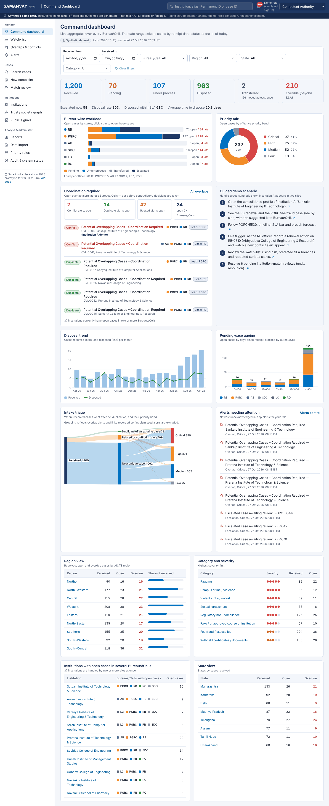
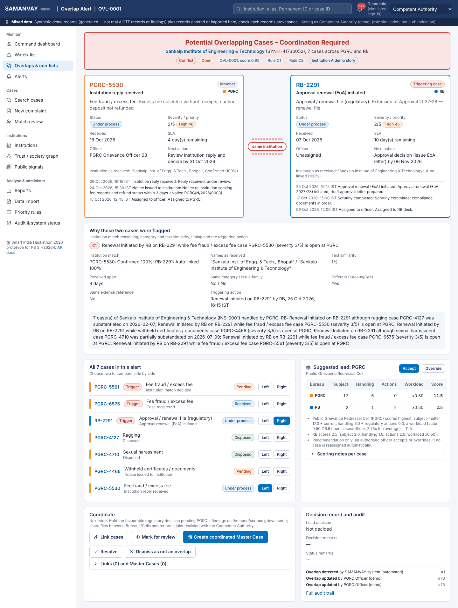
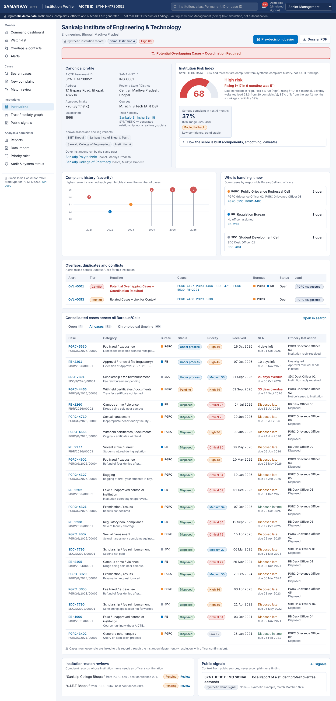
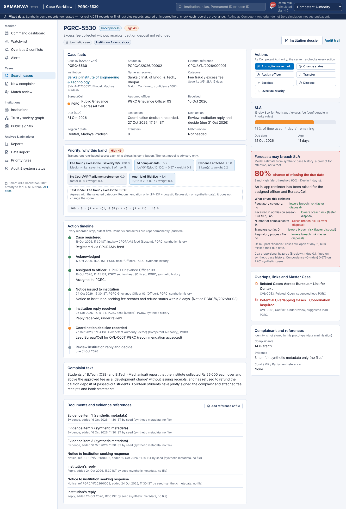
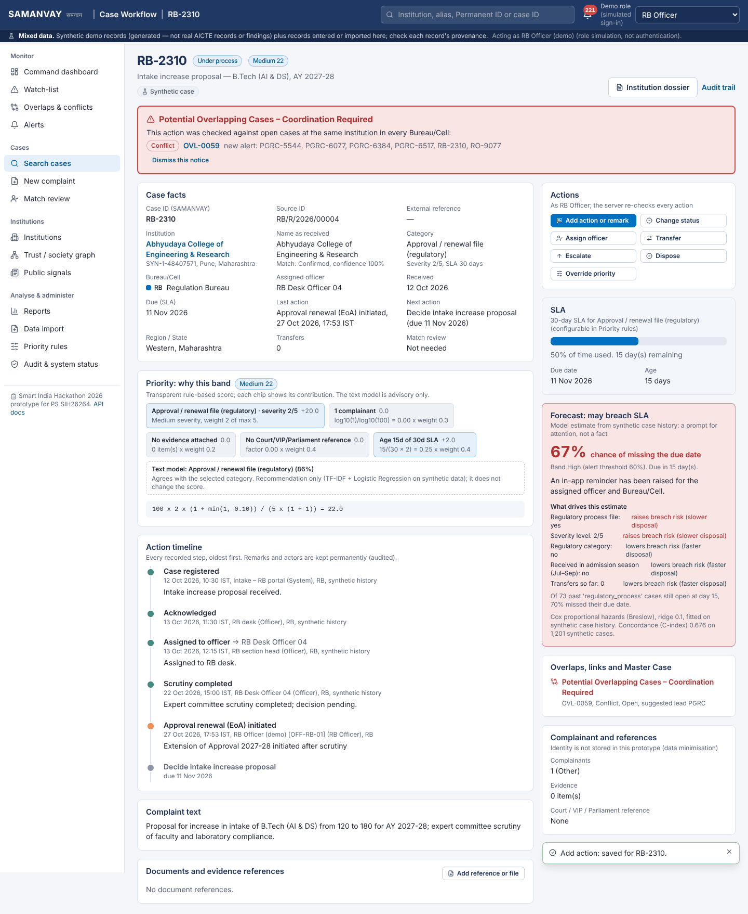
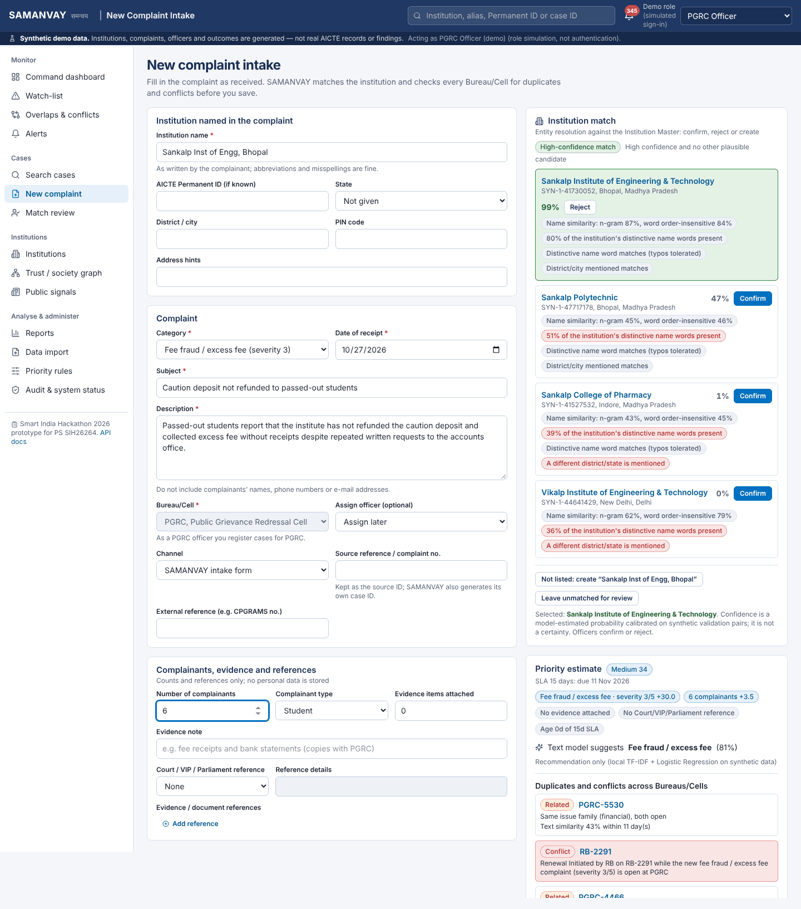
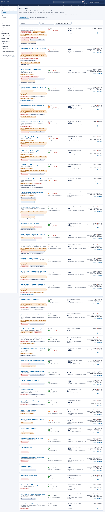
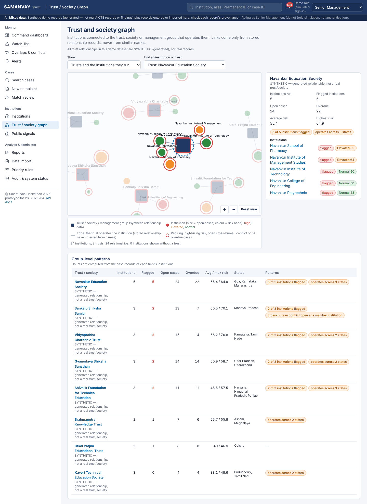
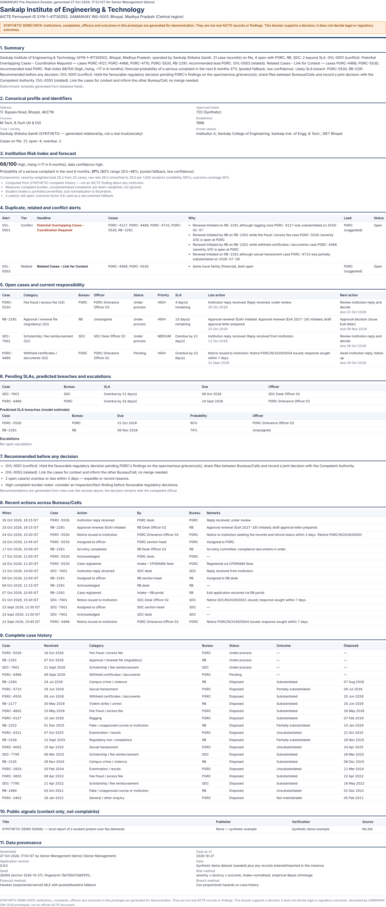
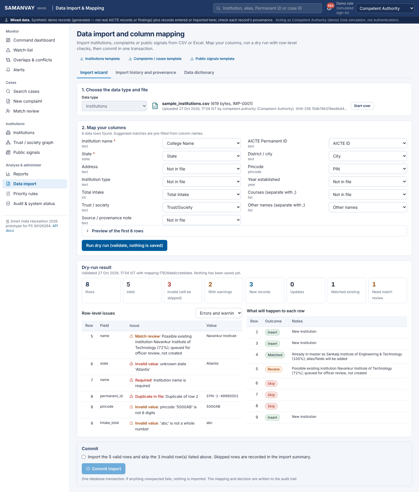

# AgniDrishti

**Integrated monitoring and coordination of institution-related complaint cases across AICTE Bureaus/Cells**

Smart India Hackathon 2026 prototype for problem statement **SIH26264**, *"Integrated Dashboard for Monitoring and Tracking Institution-Related Complaint Cases Across AICTE Bureaus/Cells"*.

*AgniDrishti* (अग्निदृष्टि) provides focused, vigilant oversight and coordination. AICTE grievances, regulatory files and inspections about one institution are handled in separate silos: the Regulation Bureau, PGRC, the Approval Bureau and other cells, and the Regional Offices. As a result, one Bureau can renew an approval while another is still investigating a ragging or fee-fraud complaint against the same institution. AgniDrishti links every case to one canonical institution record and catches these overlaps before contradictory decisions are taken. It ranks work by explainable priority and SLA risk, and gives decision-makers a one-click, evidence-backed dossier.

> **Prototype notice.**
> - All complaint data is **synthetic**: institutions, complaints, officers and outcomes. None of it is a real AICTE record or finding.
> - The role switcher **simulates** sign-in. It is not authentication.
> - This is a working hackathon prototype. It is not a production or officially deployed AICTE system.

---

## Contents
1. [What it does](#what-it-does)
2. [Screenshots](#screenshots)
3. [Quick start](#quick-start)
4. [Configuration](#configuration)
5. [Architecture](#architecture)
6. [Data: what is real, imported, signal or synthetic](#data-what-is-real-imported-signal-or-synthetic)
7. [Algorithms](#algorithms)
8. [Importing CSV/XLSX](#importing-csvxlsx)
9. [Roles and permissions](#roles-and-permissions)
10. [Audit hash chain](#audit-hash-chain)
11. [Tests and checks](#tests-and-checks)
12. [Three-minute demo script](#three-minute-demo-script)
13. [Known limitations](#known-limitations)
14. [Assumptions](#assumptions)
15. [Repository layout](#repository-layout)

---

## What it does

| Area | What you get |
|---|---|
| **Command dashboard** | Live KPIs computed from the database: received, pending, under process, disposed, transferred, overdue. Also: Bureau-wise workload, priority mix, regions and states, ageing, disposal trend, intake-triage flow, a coordination queue, recent alerts and a guided demo. Filters change every figure. |
| **Institution Master + entity resolution** | One record per institution, with aliases, Permanent ID and trust. Name variants such as "S.I.E.T Bhopal" or "Sankalp Inst. of Engg." get ranked candidates with a confidence and the reasons behind it. Officers confirm or reject; confirmations become aliases and rejections are remembered. |
| **Conflict-of-Action detector** | Three tiers: **DUPLICATE**, **RELATED** and **CONFLICT**, each fired by named rules. The Institution A story shows **"Potential Overlapping Cases – Coordination Required"**. Cases can be compared side by side, linked, merged into a Master Case (non-destructive, can be unmerged) and given a recommended lead Bureau/Cell based on subject matter and workload. |
| **Explainable priority** | A transparent score with "why" chips for severity, complainants, evidence, Court/VIP/Parliament references, age against SLA and keyword escalation. A local TF-IDF + logistic-regression text model gives an advisory category suggestion. Overrides are logged. |
| **SLA engine** | Due dates and overdue state are facts. A **breach predictor** (Cox proportional hazards) is labelled as an estimate and shows its drivers. In-app reminders, escalations and overdue alerts are included. |
| **Institution Risk Index** | 0–100, built from severity, recency decay, outcomes, intake normalisation and empirical-Bayes shrinkage. It comes with a **Hawkes** 6-month forecast that has honest fallbacks, and a **watch-list** that shows reasons, not just a rank. |
| **Trust/society graph** | A NetworkX analysis drawn as an interactive d3-force graph built only from stored relationships. Shows group patterns such as several flagged institutions under one trust. |
| **Pre-decision dossier** | One click for a printable page or a server PDF covering profile, history, open cases and owners, conflicts, risk, SLAs, recommendations and provenance. Optional AI wording is checked against the database facts. |
| **Imports** | A CSV/XLSX wizard: sheet choice, column mapping, dry run with row-level issues, commit in one transaction, summary and provenance. Includes templates and a data dictionary. |
| **Public signals** | A separate layer for verified public notices and reporting, with links and retrieval provenance. A signal never becomes a complaint. |
| **Reports** | Summaries by bureau, region, state, institution, category, status, month or quarter. Also ageing, monthly and quarterly performance, SLA compliance and overlap counts. CSV and Excel exports carry the filters, the generation time and a data notice (synthetic, or mixed once real records are entered). |
| **Audit and access** | A hash-chained audit log with verification. Five demo roles whose permissions are enforced **on the server**; refused attempts are themselves audited. |

The core application runs **fully offline** and **without** an `ANTHROPIC_API_KEY`.

## Screenshots

These were captured by the automated end-to-end tests (`e2e/test_e2e.py`) running the real application with headless Chromium. They are not mock-ups; they are saved as 256-colour PNGs to keep the repository small. The test run registers a new complaint early on, so later screenshots show the header's **"Mixed data"** notice instead of "Synthetic demo data".

| | |
|---|---|
|  **Command dashboard** |  **Institution A conflict, side by side** |
|  **Institution profile** |  **Case workflow, SLA and breach forecast** |
|  **Live conflict trigger (RB officer)** |  **Intake with live matching and overlap check** |
|  **Watch-list** |  **Trust/society graph** |
|  **Dossier (print rendering)** |  **Import dry run** |

More are in [`docs/screenshots/`](docs/screenshots/): search, master case, alerts, rules preview, reports, public signals and audit verification.

---

## Quick start

### Prerequisites
- **Python 3.11 or newer.** Verified on 3.13.17; the code also byte-compiles on 3.11 and 3.12.
- **Optional: Node.js 20 or newer** to rebuild the UI. Verified with Node 22. A **prebuilt UI is included** in `frontend/dist`, so Python alone is enough to run the app.
- About 300 MB of disk space for the Python packages.

### One command

```powershell
# Windows (double-click run.bat, or run PowerShell):
.\run.bat
# or: powershell -ExecutionPolicy Bypass -File scripts\dev.ps1
```
```bash
# Linux / macOS
./run.sh                  # or: make start  /  ./scripts/dev.sh
```

On the first run the script:
1. Creates `.venv` and installs `backend/requirements.txt`.
2. Copies `.env.example` to `.env`.
3. Builds the UI if Node.js is present.
4. Starts the server.

The server migrates the database and, **only if it is empty**, generates the synthetic dataset and trains the local models. On the build machine this first start took 8 seconds.

| What | URL |
|---|---|
| Application (UI) | http://localhost:8000 |
| Interactive API documentation (offline) | http://localhost:8000/api/docs |
| OpenAPI 3.1 document | http://localhost:8000/api/openapi.json |
| Health check | http://localhost:8000/api/health |

The UI and API share one port. There is no separate frontend server.

### Other commands

| Command | Purpose |
|---|---|
| `make dev` | Development mode: the UI rebuilds on change and the API reloads |
| `make setup` | Install backend, test and UI dependencies (`backend/requirements-dev.txt`, `npm install`) |
| `make seed` | Seed only if the database is empty (safe, never deletes) |
| `make reset-db` | **Delete all data** (including the audit log) and regenerate the demo dataset. Asks you to type `reset`. Non-interactive form: `cd backend && ../.venv/bin/python -m app.seed --reset --yes` |
| `make test` | Backend unit and API integration tests |
| `make e2e` | End-to-end browser tests (needs `pip install -r backend/requirements-dev.txt` and `python -m playwright install chromium`) |
| `make check-views` | With the server running: every view at phone and desktop width, page errors and external requests |
| `make lint` / `make typecheck` | `ruff` and strict TypeScript checks |
| `make build` | Rebuild `frontend/dist` |
| `make types` | Regenerate `frontend/src/api/types.gen.ts` from the OpenAPI document |
| `make models` | Retrain the local models |
| `make samples` | Regenerate the sample import files |

Manual start, without the script:

```bash
python3 -m venv .venv && .venv/bin/pip install -r backend/requirements.txt
cd backend && ../.venv/bin/python -m uvicorn app.main:app --port 8000
```

### Reproducing the exact numbers in this README
By default the dataset is anchored to the date of first seeding, and the app uses the real date. The values in this README, the tests and the screenshots were produced with:

```
AGNIDRISHTI_SEED=26264  AGNIDRISHTI_SEED_ANCHOR=2026-10-27  AGNIDRISHTI_TODAY=2026-10-27
```

Set these in `.env` and run `make reset-db` to get identical data. The fingerprint is `15b750d7…`, shown under **Audit & system status → System status**.

Without these settings the dataset is anchored to the day of the first start, so action counts, alerts and KPIs come out slightly different. The 60 institutions, the 1,200 cases and the Institution A story stay the same. For example, a fresh copy started on 2026-10-28 showed 191 overdue cases (210 in the reference data) and a risk index of 69 for Institution A (68.1 in the reference data).

With a frozen date, new events keep that date. Their time of day is the real one, but never earlier than the latest stored event, so the newest entry always sorts last, even after midnight or a restart.

---

## Configuration

All settings are environment variables. See [`.env.example`](.env.example); a real `.env` is git-ignored. (Both `AGNIDRISHTI_*` and `SAMANVAY_*` prefixes are supported).

| Variable | Default | Meaning |
|---|---|---|
| `DATABASE_URL` | `sqlite:///backend/var/agnidrishti.db` | SQLite only in this build (see limitations) |
| `AGNIDRISHTI_SEED` | `26264` | Random seed for the synthetic generator |
| `AGNIDRISHTI_SEED_ANCHOR` | *(date of first seed)* | The dataset's "today" when seeding |
| `AGNIDRISHTI_TODAY` | *(real date, IST)* | Freezes the app's date for reproducible demos and tests |
| `AGNIDRISHTI_AUTO_SEED` | `1` | Seed an empty database on start |
| `AGNIDRISHTI_MODELS_DIR`, `AGNIDRISHTI_STORAGE_DIR` | `backend/var/…` | Trained models; uploaded document files |
| `AGNIDRISHTI_MAX_UPLOAD_MB` | `10` | Upload size limit (imports, documents) |
| `AGNIDRISHTI_LOG_LEVEL` | `INFO` | Server log level |
| `AGNIDRISHTI_DEFAULT_DEMO_USER` | `senior.mgmt` | Demo user assumed when a request has no `X-Demo-User` header (a read-only role) |
| `AGNIDRISHTI_FRONTEND_DIST` | `frontend/dist` | Folder the built UI is served from |
| `ANTHROPIC_API_KEY` | *(empty)* | **Optional.** Used only for AI-assisted dossier wording and an API-only category suggestion |
| `ANTHROPIC_MODEL`, `ANTHROPIC_TIMEOUT_S` | `claude-haiku-5-5`, `20` | Model and timeout for those optional calls |

### Optional Anthropic API key
If `ANTHROPIC_API_KEY` is set, the dossier page offers **AI-assisted wording** for its summary paragraph. Safeguards:
- The model may only rephrase the deterministic template.
- Every case ID and number in its output must exist in the database facts; otherwise the template is used and the rejection is shown.
- The result is labelled AI-assisted, and the structured sections never come from the model.
- The key stays on the server and is never sent to the browser.

The API also accepts `"use_llm": true` on `POST /api/classify` for an optional AI category suggestion next to the local model's. The UI does not use this.

Without a key, or with no network, the template text is used and everything else works unchanged. The other features (classification, matching, risk, forecasting, conflicts) are local models and rules.

**Verification status:** no API key or outbound network was available while building, so **no live call to the Anthropic API was made**. The tests cover the no-key path and the accept/reject/fallback logic with the model call stubbed (`test_ai_narrative_paths_with_stubbed_model`).

---

## Architecture

```
 Browser (React 19 + TypeScript + Tailwind v4, d3 charts / d3-force graph)
        |  fetch /api/*  (header X-Demo-User = simulated role)
        v
 Starlette app (app/main.py) ── typed routes (app/core/api.py: Pydantic validation, permission check,
        |                          OpenAPI 3.1, uniform errors, 403s written to the audit chain)
        +── domain services ──────────────────────────────────────────────────────────────────────
        |   institutions/  matcher (TF-IDF + calibrated LR), aliases, match reviews
        |   complaints/    intake preview/create, queries & filters      workflow/  status, assign,
        |   conflicts/     detector (D/R/C rules), lead recommender,        transfer, escalate,
        |                  links, Master Cases                               dispose, documents
        |   scoring/       priority engine, category classifier, rules editor
        |   sla/           SLA facts, Cox breach model          risk/  risk index, Hawkes, watch-list
        |   graph/         NetworkX trust graph                 alerts/ in-app alerts + sweep
        |   reports/       tables + CSV/XLSX                    dossier/ JSON, PDF (ReportLab)
        |   imports/       CSV/XLSX wizard                      signals/ public-signal layer
        |   audit/         hash chain + verification            system/  me, reference, status, search
        |   seed/          deterministic synthetic generator + Institution A story
        v
 SQLite (WAL) ── versioned SQL migration (28 tables) ── backend/var/agnidrishti.db
 Local models ── backend/var/models (classifier, matcher)    Files ── backend/var/storage
```

**Data flow for a new complaint:**
1. Intake form: live institution matching (`POST /api/institutions/match`).
2. Preview (`POST /api/cases/preview`): priority, SLA, possible duplicates and conflicts.
3. Officer confirms the institution (or creates one, or leaves it for review).
4. `POST /api/cases` writes the case, its first timeline entry, its priority, the match decision and an audit event, and runs the overlap detector, all in one transaction.
5. Any new overlap alert appears for the Bureaus/Cells involved, in the alerts centre and on the cases.

**Main tables** (`backend/app/db/migrations/0001_init.sql`):
- `institutions`, `institution_aliases`, `trusts`
- `complaints` (cases), `case_actions` (timeline), `case_documents`, `case_links`
- `master_cases`, `master_case_members`
- `overlap_alerts`, `overlap_alert_cases`, `match_reviews`, `match_feedback`
- `alerts`, `priority_overrides`, `category_rules`, `app_settings` (rules as data, not code)
- `audit_events`, `import_jobs`, `import_row_issues`, `public_signals`
- Reference tables: `bureaus`, `regions`, `states`, `officers`, `demo_users`

### Stack, and deviations from the requested stack
The build sandbox had no access to the PyPI or npm registries (HTTP 403). The prototype therefore uses the locally available equivalents:

| Requested | Used | Note |
|---|---|---|
| FastAPI | **Starlette + Pydantic** with a small in-repo FastAPI-style router (`app/core/api.py`) | Typed bodies and queries, validation, OpenAPI 3.1 and an offline `/api/docs` page. 74 endpoints. |
| SQLAlchemy, PostgreSQL by configuration | **stdlib `sqlite3`** with a versioned, checksummed SQL migration | **PostgreSQL is not supported in this build.** A non-SQLite `DATABASE_URL` is rejected with a clear message. |
| pandas | `csv` + `openpyxl` | Not needed |
| rapidfuzz | In-repo RapidFuzz-style ratios (`institutions/fuzzy.py`) | Same idea: token set, sort and partial ratios |
| Vite | **esbuild** via `frontend/build.mjs`; Tailwind CSS v4 compiled through its JS API | One bundle; content-hashed assets |
| Recharts / ECharts, force-graph library | **d3-scale / d3-shape / d3-sankey** SVG charts and a **d3-force + d3-zoom** graph | Maintained d3 modules, no hosted services |

No remote fonts, map tiles, CDNs or chart services are used. The UI uses the platform's system font stack.

---

## Data: what is real, imported, signal or synthetic

| Kind | Where it appears | Status in this build |
|---|---|---|
| **Synthetic complaint history** | All 1,200 seeded cases, 7,545 actions, outcomes and officers | Generated. Labelled "Synthetic" in the UI, reports, exports and dossier. |
| **Institution records** | 60 seeded institutions | **Fictional** names with `SYN-…` Permanent IDs. No bulk public AICTE institution dataset could be downloaded and verified from the sandbox, so no real institution is paired with synthetic complaints. |
| **Trust/society relationships** | 8 trusts | Synthetic relationships, marked with their provenance |
| **Imported data** | Anything loaded through the import wizard or entered on the intake form | Labelled "Entered / imported record" or "Imported record". Once any such complaint exists, the header ribbon, dashboard, report exports and dossiers switch from the synthetic notice to a **mixed-data** notice. The system-status page counts these records. |
| **Public signals** | `/signals` | 5 verified public sources (below) plus 3 clearly labelled **synthetic demo** signals with no URL |

### Synthetic-data method
`backend/app/seed/` contains a deterministic generator (seed 26264):
- **Institutions:** 60 across 23 states and 9 regions, with 129 recorded aliases: 120 abbreviations and short forms, 7 former names and 2 demo labels.
- **Name variants:** over a third of the complaints name their institution by a variant (misspelt, abbreviated or a former name), which the matcher has to resolve.
- **Cases:** 1,200 from 2019 to the anchor date, with admission-season peaks, yearly growth, self-exciting clusters of serious complaints, Bureau-specific speeds, transfers, escalations and outcomes.
- **Other records:** 3,352 evidence/document metadata records, no files.
- **Planted patterns:** near-duplicate filings, a rising-risk institution (Prerana, Warangal), a trust with several flagged institutions (Navankur Education Society) and a live-trigger institution (Abhyudaya, Pune).
- **Determinism:** the generator is idempotent. Re-running it does nothing unless `--reset` is given, and a dataset fingerprint is stored and audited.

**Hand-seeded Institution A story** (*Sankalp Institute of Engineering & Technology, Bhopal*, alias "Institution A"):
1. Older ragging case **PGRC-4127**: substantiated.
2. Fee-fraud case **PGRC-5530**: under process at PGRC.
3. RB renewal file **RB-2291** with a *Renewal initiated* action.
4. The detector raises **OVL-0001 – "Potential Overlapping Cases – Coordination Required"**, with PGRC suggested as lead.

**Snapshot note:** most open cases in the seeded snapshot are already past their SLA (about 210 of 237). Fitting 1,200 cases over 2019–2026 leaves a backlog-heavy pending book, which exercises the SLA and alert features. The generator parameters (`seed/generator.py`) control this.

### Public sources actually used
The build assistant's web-fetch tool fetched each URL on **2026-10-27**. Each summary is a short paraphrase written for AgniDrishti. None names an institution in the fictional Institution Master, so all five are stored as *sector-wide* context with match status `NO_MATCH`. Retrieval times are approximate to the hour.

| Title | Publisher | Published | URL |
|---|---|---|---|
| AICTE Public Notice for Approval Process 2025-26 | AICTE | 2024-11-04 | https://aicte.gov.in/sites/default/files/Public%20Notice%202025-26.pdf |
| Lok Sabha Unstarred Question No. 1784: AICTE list of unapproved technical institutes | Lok Sabha Digital Library | 2020-03-02 | https://eparlib.nic.in/bitstream/123456789/970096/1/AU1784.pdf |
| Lok Sabha answer on warning the public against fake universities and unapproved courses | Ministry of Education | 2018-07-30 | https://www.education.gov.in/sites/upload_files/mhrd/files/lu1929.pdf |
| Public Notice on fake or bogus technical institutions and courses in Haryana | Directorate of Technical Education, Haryana | 2017-01-13 | https://hsbte.org.in/images2/Public_Notice.pdf |
| Govt puts up list of fake technical colleges | The Tribune | 2017-01-21 | https://www.tribuneindia.com/news/archive/governance/govt-puts-up-list-of-fake-technical-colleges-353101 |

**Failures and limits:**
- The optional acquisition script `scripts/acquire_public_data.py` checks `robots.txt` first and caches raw copies to `backend/var/public_cache/` with a manifest. It **cached 0 of 5 sources** in the build sandbox because the outbound proxy refused the connections. It records failures rather than inventing content; run it on a machine with internet access.
- The application never needs the network at runtime.
- **No AICTE institution list was imported.** Use the import wizard with a verified file if one is available.

---

## Algorithms

All parameters below are **editable data** on the *Priority rules* screen. Every change is validated, previewed, saved and audited with before and after values.

### Entity resolution (`institutions/matcher.py`)
**Pipeline**
1. Canonicalise the name: expand abbreviations such as *Inst., Engg., Tech.*, drop stop-words, fold punctuation and case.
2. Generate candidates with TF-IDF character n-grams over names and aliases, plus Permanent ID and acronym look-up ("S.I.E.T").
3. Compute 13 pairwise features: TF-IDF cosine, token ratios, IDF-weighted word coverage, distinctive "brand" word, exact alias, PIN code, district/state agreement or conflict, Permanent ID agreement or conflict.
4. Score with a logistic regression **trained on synthetic labelled pairs** generated from the Institution Master. On held-out synthetic pairs: Brier score 0.0043, accuracy 99.4% (5,463 pairs).

**Routing**
- **AUTO_LINK** needs confidence ≥ 0.90 *and* a runner-up below 0.55.
- Otherwise the match goes to **REVIEW** (≥ 0.55) or **NO_MATCH**. Low-confidence matches are never linked silently.

**Feedback.** Officer confirmations become aliases; rejections are stored and down-weight that pairing.

**Limitations.** The confidence is calibrated only on synthetic variants, and real-world accuracy is unknown.

### Priority (`scoring/priority.py`)
`score = 100 × W × (1 + min(cap, Σ wₖ·mₖ)) / (W_max × (1 + cap))`

- **W:** the category's severity weight, from 1 to 5. If a more severe category's keyword appears in the text, its weight is used and a chip says so.
- **Modifiers mₖ in [0,1], with their weights:**
  - complainants: log scale, weight 0.3
  - evidence attached: 0.2
  - Court/Parliament/VIP reference: 0.4
  - age against SLA: 0.4
- **Cap:** 1.0.
- **Bands:** Critical ≥ 50, High ≥ 35, Medium ≥ 20, otherwise Low.
- Each term is shown as a "why" chip in score points.

The text classifier is TF-IDF word 1–2-grams with logistic regression. Its macro-F1 of 1.0 is measured on held-out *synthetic template* texts and overstates real accuracy, so it is advisory only and contributes 0 points. Officer overrides change the band, not the score, and are logged with reason, officer, Bureau and time.

### Conflict tiers (`conflicts/detector.py`)
Cases are compared **only within the same confirmed institution**, and a named rule must fire. Precedence: CONFLICT > DUPLICATE > RELATED.

- **DUPLICATE**
  - **D1:** same external reference.
  - **D2:** same category, text similarity ≥ 0.45, within 60 days.
  - **D3:** same issue family, similarity ≥ 0.75, within 150 days.
- **CONFLICT** (cases at two different Bureaus/Cells)
  - **C1:** a favourable regulatory action in the last 120 days (renewal initiated, approval granted, extension of approval, intake increase proposed or approved, NOC issued) while another Bureau has an *open* grievance of severity ≥ 3.
  - **C2:** a favourable action while another Bureau's grievance of severity ≥ 4 was *substantiated* (fully or partly) in the last 730 days.
  - **C3:** an adverse action (show-cause notice, closure order, withdrawal of approval, penalty) while another Bureau's open grievance of severity ≥ 2 is still awaiting the institution's response.
  - **C4:** parallel fact-finding: both Bureaus ordered inspections on the same issue family in the last 90 days, with both cases open.
- **RELATED** (within 365 days)
  - **R1 / R3:** same issue family and both cases open (R3 when they sit with two different Bureaus).
  - **R2:** text similarity ≥ 0.30, with at least one case open.

The detector runs on case creation, on workflow and regulatory actions, after match confirmation, after imports and on demand. A new finding is merged into an open alert of the same institution and tier that already shares a case, so one situation produces one alert. Pairs that an officer has resolved or dismissed are not raised again.

### Lead Bureau/Cell (`conflicts/lead.py`)
`score(b) = (subject + handler + action points) × workload_factor`

- **Subject points:** severity weights of the overlapping cases whose category *b* normally handles (open cases count fully, disposed ones at half weight).
- **Handler points:** 0.5 × the weights of open cases *b* currently holds.
- **Action points:** 2.0 per regulatory action *b* took on these cases in the last 120 days.
- **workload_factor:** `clamp(1 − 0.6 × (load_ratio − 1), 0.5, 1.2)`, where `load_ratio` is *b*'s open cases per officer relative to the average.

The UI shows the recommendation with its rationale. It is advisory: an authorised officer accepts or overrides it (with remarks), both are audited, and nothing is reassigned automatically.

### Institution Risk Index (`risk/index.py`)
`load = Σ severity_weight × 0.5^(age/365 d) × outcome_factor`

- **Outcome factors:** substantiated 1.0, partly 0.7, open 0.6 (the fallback when no outcome is known yet), unsubstantiated 0.2, withdrawn / not maintainable 0.1.
- **Exposure:** intake ÷ 1,000. If intake is unknown, 600 is used and confidence is lowered.
- **Shrinkage:** `rate = (load + k·pop_rate)/(exposure + k)` with `k = 0.5` (500 students), so a single case cannot produce an extreme score.
- **Index:** `100·rate/(rate + median_rate)`, so 50 is the median institution.
- **Bands:** High ≥ 65, Elevated ≥ 57.
- **Trend:** the index today compared with 182 days ago, on today's scale.

The profile shows every component, the caveats and the data coverage. It is a complaint-burden indicator on synthetic data, **not a finding of wrongdoing**.

### Serious-complaint forecast (`risk/hawkes.py`)
**Model.** A univariate Hawkes process with an exponential kernel, `λ(t) = μ + αβ Σ e^{−β(t−tᵢ)}`, fitted by maximum likelihood (L-BFGS-B, several starts, bounded).

**Safeguards**
- Fewer than the minimum number of events, an unstable fit, or α at its bound → **POOLED_FALLBACK**: pooled α and β, with the institution's background rate shrunk towards the pool.
- No events → **BASELINE**.

**Output.** P(at least one serious complaint in the next 6 months) with an 80% range, a confidence label, and a rising/falling/stable trend. Institution A, for example, honestly uses the pooled fallback with low confidence.

### SLA and breach risk (`sla/engine.py`, `sla/breach.py`)
**Facts.** Due date = receipt date + category SLA. The SLA days are illustrative: 7 days for safety categories; 15 for fee, certificate, scholarship and examination complaints (the "standard student grievance" example); 30 for regulatory and approval files. Overdue state is a fact. No pauses or exemptions are modelled.

**Prediction.** A Cox proportional-hazards model of time to disposal: Breslow baseline, ridge penalty, censoring for open cases.
- **Covariates:** severity, issue family, Bureau, transfers, complainants, evidence, references, admission season.
- **Formula:** `P(breach) = exp(−(H₀(due) − H₀(age)) · e^{βx})`.
- **Fit:** C-index 0.676 on the synthetic history.

The case page shows the probability, the drivers (as hazard ratios turned into plain language) and a historical comparison. Current backlog is shown only as context, because using it as an input would extrapolate.

**Alerts.** SLA warnings 3 days before the due date, overdue notices, pending reminders after 14 idle days, predicted breaches (probability ≥ 0.6) and escalations. They are **in-app only**: no e-mail or SMS provider is configured.
- **Event alerts** (overlaps, escalations, transfers, match reviews) are raised as the event happens.
- **Time-based alerts** come from a sweep that runs at start-up, after imports and when the Competent Authority clicks *Refresh time-based alerts*. There is no background scheduler, so a server left running for days needs that click or a restart to raise new SLA warnings.

---

## Importing CSV/XLSX
1. Open **Data import**, choose *Institutions*, *Complaints* or *Public signals* (the last is Competent Authority only), and upload a `.csv` or `.xlsx` file (≤ 10 MB).
2. For workbooks, **choose the sheet**.
3. **Map columns.** Suggestions come from column-name synonyms, and required fields are marked. The data dictionary and the CSV/XLSX templates are on the same screen.
4. **Run the dry run.** Nothing is saved. You get counts (valid, invalid, new, updated, matched, needs review), **row-level issues** (invalid date, unknown category or state, duplicate in file, missing required value, bad PIN, and so on) and the planned outcome of each row.
5. **Commit.** If there are invalid rows you must tick *"import the valid rows and skip the invalid ones"*. The policy is **skip invalid rows only after explicit acknowledgement**. The commit runs in one transaction, so any unexpected error imports nothing. A changed mapping since the dry run is refused (HTTP 409).
6. The summary lists inserted, updated, matched, review-queued and skipped rows. Source IDs are preserved and internal IDs generated. Institution names that cannot be matched with confidence go to **Match review**.

Every upload, dry run and commit is audited with the file checksum, sheet, mapping and uploader.

Sample files with deliberate errors are in `backend/data/samples/`:
- `sample_institutions.csv`: 8 rows, 3 invalid.
- `sample_complaints.xlsx`: a "Read me" sheet plus "Complaints Register" with 12 rows, 5 invalid.

---

## Roles and permissions

> The header's **demo role** selector simulates sign-in for evaluation. The browser sends the chosen role as the `X-Demo-User` header, and **every permission and object-level rule is checked on the server**. This is not authentication: anyone who can reach the server can choose a role, so do not expose this prototype on a public network.

| Demo user | Role | Scope |
|---|---|---|
| `competent.authority` | Competent Authority | Everything; final decisions on cross-bureau conflicts, rules, unmerge |
| `rb.officer` | RB Officer (OFF-RB-01) | Acts on **RB** cases only; can record regulatory actions |
| `pgrc.officer` | PGRC Officer (OFF-PGRC-03) | Acts on **PGRC** cases only |
| `ro.central` | Regional Office (Central) | Sees **Central region** cases only; remarks, documents, escalation |
| `senior.mgmt` | Senior Management | Read-only analytics, exports and audit verification |

| Permission | What it allows | RB Officer | PGRC Officer | Regional Office | Senior Mgmt | Competent Authority |
|---|---|---|---|---|---|---|
| `dashboard.view` … `import.view` | View dashboard, institutions, cases, overlaps, alerts, risk, graph, reports, dossier, signals, rules, audit and import history | ✓ | ✓ | ✓ (own region) | ✓ | ✓ |
| `case.create` | Register a new complaint | ✓ (own bureau) | ✓ (own bureau) | ✓ (own region) | — | ✓ |
| `case.update` | Status change, assignment and actions on permitted cases | ✓ (own bureau) | ✓ (own bureau) | ✓ (remarks, documents, escalation; own region) | — | ✓ |
| `case.transfer` | Transfer to another Bureau/Cell | ✓ | ✓ | — | — | ✓ |
| `case.escalate` | Escalate a case | ✓ | ✓ | ✓ | — | ✓ |
| `case.dispose` | Dispose with outcome | ✓ | ✓ | — | — | ✓ |
| `case.document` | Add document references and files | ✓ | ✓ | ✓ | — | ✓ |
| `case.priority_override` | Override the computed priority (reason mandatory) | ✓ | ✓ | — | — | ✓ |
| `match.review` | Confirm or reject institution matches | ✓ | ✓ | ✓ | — | ✓ |
| `overlap.act` | Link cases, mark an overlap alert for review | ✓ | ✓ | ✓ | — | ✓ |
| `overlap.merge` | Merge eligible same-bureau duplicates into a Master Case | ✓ | ✓ | — | — | ✓ |
| `overlap.decide` | Accept or override the lead recommendation; resolve or dismiss non-conflict alerts | ✓ | ✓ | — | — | ✓ |
| `overlap.final` | Final resolution of cross-bureau CONFLICT alerts; cross-bureau Master Cases; unmerge | — | — | — | — | ✓ |
| `alert.act` | Acknowledge, resolve or dismiss alerts | ✓ | ✓ | ✓ | — | ✓ |
| `report.export` | Export reports and dossiers | ✓ | ✓ | ✓ | ✓ | ✓ |
| `import.run` | Upload, validate and commit imports | ✓ | ✓ | — | — | ✓ |
| `audit.verify` | Run hash-chain verification | ✓ | ✓ | — | ✓ | ✓ |
| `rules.edit` | Edit or reset rules | — | — | — | — | ✓ |
| `signals.import` | Import public signals | — | — | — | — | ✓ |
| `system.sweep` | Re-run alert sweeps and overlap scans | — | — | — | — | ✓ |

**Object-level rules are applied on top of these permissions.** For example, an RB officer can view a PGRC case but every change to it returns **403**. Refused write attempts are written to the audit log as `ACCESS_DENIED`. The live matrix is under **Audit & system status → Roles and permissions** and at `GET /api/system/permissions`.

---

## Audit hash chain
Every meaningful action writes an `audit_events` row with:
- actor, role, Bureau and time
- action, entity type and ID
- before and after values
- remarks
- `payload_hash = sha256(canonical(before, after, remarks))`
- `hash = sha256(canonical(event fields + payload_hash + prev_hash))`

Actions covered include creation, matching, assignment, status, actions and remarks, documents, links, merges, transfers, escalations, overrides, rule edits, imports, exports, dossier generation and denied access.

**Verify now** (`POST /api/audit/verify`) recomputes every link from the genesis hash. Editing, deleting or re-ordering any row breaks the chain from that point; the end-to-end test tampers with an event to show this.

**Limitation:** the chain is tamper-*evident* only within this database. Whoever controls the file could rewrite the whole chain, so production use needs an external anchor such as periodic publication of the head hash or WORM storage.

---

## Tests and checks
These commands were run for this build. Results are from the final run.

| Check | Command | Result |
|---|---|---|
| Backend unit and API integration tests | `cd backend && ../.venv/bin/python -m pytest` | **54 passed** (about 21 s) |
| Python lint (settings in `ruff.toml`) | `ruff check backend/app backend/tests scripts e2e` | **clean** |
| End-to-end, critical paths a–r, headless Chromium | `make e2e` | **18 passed** (about 52 s, fresh auto-seeded server) |
| UI type check | `cd frontend && node node_modules/typescript/bin/tsc -p tsconfig.sandbox.json` | **0 errors**. The official `@types/react` package could not be downloaded in the build sandbox, so this ran against a strict local stand-in (`frontend/types-sandbox/`). `npm run typecheck` with the real package was **not** run. |
| UI build | `cd frontend && node build.mjs` | 559 kB JS (169 kB gzip) and 39 kB CSS; the build is reproducible (same content hash on rebuild) |
| Views at phone and desktop width | `make check-views` (`e2e/check_views.py`, server running) | all 21 views: no horizontal overflow at 390 px and no page errors |
| Generated API types up to date | `python -m app.tools.gen_ts --check` | up to date |
| No external requests | same script, recording every request | 332 requests, **0** to hosts other than the local server |
| Fresh copy of the package | unzip, then `PORT=8100 ./scripts/dev.sh` | one command created `.env`, rebuilt the UI (same content hash), seeded the data in about 5 s and served the UI, `/api/docs` and the API. The backend, end-to-end, lint, type and generated-types checks all passed again in that copy. With Node.js removed from `PATH` the script served the prebuilt UI. |

**Not exercised:** downloading packages (`pip install`, `npm install`), because both registries were unreachable from the build sandbox; the fresh-copy check used a virtual environment with the packages already installed. `scripts/dev.ps1` was not run (no PowerShell available).

**What the tests cover**
- **Backend tests:**
  - seed determinism and idempotency
  - entity resolution
  - priority and SLA
  - Cox breach model
  - all conflict tiers, including lead recommendation under workload
  - risk shrinkage and Hawkes fallbacks
  - trust-graph integrity
  - audit tamper detection
  - OpenAPI completeness
  - server-side role restrictions
  - every search filter
  - dashboard and report totals against SQL
  - CSV export contents
  - dossier JSON and PDF
  - AI-narrative validation, plus the accept, reject and fallback paths with the model call stubbed
  - both sample imports
  - public-signal separation
  - overlap link, merge and unmerge through the API
  - persistence across a restart, and the switch to mixed-data notices once a real record exists
  - regressions: rule edits are always picked up, and a frozen clock never goes backwards
- **End-to-end tests (`e2e/test_e2e.py`)**, one per required critical path:
  - (a) dashboard KPIs against the database and filters
  - (b) search by name, alias, Permanent ID, case ID, bureau, region, category, status and dates
  - (c) institution profile and dossier, with the PDF download and print rendering
  - (d) intake with live matching and an overlap check on submit
  - (e) match confirm and reject, with audit
  - (f) the exact Institution A warning and a **live trigger**
  - (g) link and merge, with originals kept, then unmerge
  - (h) lead accept
  - (i) status, assignment, remark, transfer and escalation, with timeline and audit
  - (j) SLA, breach explanation and alert acknowledgement persisted
  - (k) rule edit, recalculation, override and audit
  - (l) watch-list and trust cluster
  - (m) CSV export contents
  - (n) both imports with invalid rows
  - (o) public-signal links
  - (p) role denial enforced by the server
  - (q) chain verification and tamper detection
  - (r) restart persistence

### Acceptance criteria status
| # | Criterion | How it was checked | Status |
|---|---|---|---|
| 1 | One-command fresh setup | Fresh unzipped copy started with `./scripts/dev.sh` (see above) | **Partially verified**: package download not exercised offline |
| 2 | About 60 institutions and 1,200 synthetic cases, reproducible | `test_seed.py` (counts, fingerprint, idempotency) | Verified |
| 3 | Institution A story and the exact warning | `test_conflicts.py`, `test_seed.py`, e2e (f) | Verified |
| 4 | Dashboard from persisted data; filters change results | `test_api.py` (against SQL), e2e (a) | Verified |
| 5 | Entity-match candidates with confidence and reasons; confirm/reject | `test_matching.py`, e2e (d, e) | Verified |
| 6 | Priority "why" chips; rule edits and overrides persist and are audited | `test_priority_sla.py`, e2e (k) | Verified |
| 7 | Duplicate/related/conflict tiers; link; non-destructive merge | `test_conflicts.py`, `test_api.py`, e2e (g) | Verified |
| 8 | Lead Bureau from category and workload, with rationale | `test_conflicts.py` (workload changes the answer), e2e (h) | Verified |
| 9 | Normalised, smoothed risk with inputs; honest sparse-data forecast | `test_risk_graph_audit.py` | Verified, on synthetic data only |
| 10 | Trust graph from stored relationships, interactive, links to institutions | `test_risk_graph_audit.py`, e2e (l) | Verified |
| 11 | Dossier with profile, history, responsibility, conflicts, risk, provenance; print/export | `test_api.py` (JSON, PDF), e2e (c) | Verified |
| 12 | SLA facts, explained breach risk, persistent alerts | `test_priority_sla.py`, e2e (j) | Verified |
| 13 | Hash-chained, verifiable audit; server-side role checks | `test_risk_graph_audit.py`, `test_api.py`, e2e (p, q) | Verified |
| 14 | All required screens, backed by persisted data | 21 views loaded in the responsive and network checks; e2e (a–r) | Verified |
| 15 | Search by institution, Permanent ID, case ID, Bureau, region, category, status, dates | `test_api.py`, e2e (b) | Verified |
| 16 | Reports by bureau, region, institution, ageing, disposal rate, overlaps, month/quarter; CSV export | `test_api.py` (CSV and XLSX), e2e (m) | Verified |
| 17 | CSV/XLSX import with mapping, preview, validation, dry run, commit, row-level summary | `test_api.py`, e2e (n) | Verified |
| 18 | Public signals kept apart from complaints; real links only when verified | `test_api.py`, `test_seed.py`, e2e (o) | Verified; raw copies not cached |
| 19 | Runs offline and without `ANTHROPIC_API_KEY` | Every suite ran with the key empty; no external requests | Verified |
| 20 | Tests, UI checks, build and e2e run; results reported as they are | This section | Verified; UI types checked against a local stand-in for `@types/react` |

---

## Three-minute demo script
Start with `make start`, open http://localhost:8000 as **Competent Authority** (the default), and follow the **Guided demo scenario** card on the dashboard. The numbers quoted below come from the reference dataset (2026-10-27). With another start date they differ slightly (see [Reproducing the exact numbers](#reproducing-the-exact-numbers-in-this-readme)).

| Time | Do | Say |
|---|---|---|
| 0:00 | **Command dashboard.** Point at the KPIs and *Coordination required*. | "Every number comes live from 1,200 synthetic cases across six Bureaus/Cells. 37 institutions currently have open cases in two or more silos." |
| 0:25 | Guided step 1 → **Institution A profile** | "One canonical record: aliases such as 'SIET Bhopal' and 'Institution A', cases from PGRC, RB and SDC, who owns each one, and a Risk Index of 68, rising +17 in six months, with its components and caveats." |
| 0:55 | Click the red banner → **OVL-0001** | "**Potential Overlapping Cases – Coordination Required.** RB has initiated a renewal while a PGRC fee-fraud case is open and a ragging case was substantiated earlier this year. Each rule is named. The suggested lead is PGRC, based on subject matter and current workload." Click **Accept** → **Accept lead**. |
| 1:30 | Header → switch role to **RB Officer**. Open **RB-2310** (Abhyudaya) → *Add action or remark* → **Approval renewal (EoA) initiated** → *Add action*. | "Recording a favourable regulatory action checks every Bureau instantly. A new conflict alert appears before the approval goes out." |
| 1:55 | Open **PGRC-5530** (still as RB Officer) | "The RB officer can read the PGRC case but has no actions, and the server would refuse them anyway. The priority shows its 'why' chips. The SLA bar is at 73%, and the forecast estimates an 80% chance of missing the due date, with its drivers." |
| 2:20 | Switch to **PGRC Officer** → **New complaint** → type "Sankalp Inst of Engg, Bhopal", category *Fee fraud*, a subject and a description | "Live entity resolution gives a 99% match with its reasons, and possible duplicates and conflicts show before saving." |
| 2:40 | **Institution A → Pre-decision dossier** → *Print / save as PDF* | "One click gives the decision-maker the full picture with provenance." |
| 2:55 | **Audit & system status → Verify now** | "Every step you saw is in a tamper-evident hash chain. Chain intact." |

---

## Known limitations
- **Stack substitutions** (see the table above). **PostgreSQL is not supported**: SQLite only, single process.
- **Authentication is simulated** by the role switcher; there is no real identity verification. Do not expose the server publicly.
- **Synthetic data only.**
  - All complaint history, outcomes, officers and trusts are generated, and the institutions are fictional.
  - The models (classifier, matcher, breach model, risk index and forecast) are trained or calibrated on that synthetic data, so their reported metrics overstate real-world performance.
  - The seeded snapshot is backlog-heavy.
- **Public data acquisition:** the cache script fetched 0 of 5 sources in the sandbox (network blocked). No real AICTE institution list was imported.
- **UI type-check** was verified against a local React type stand-in, not the official `@types/react`. ESLint is not configured, so "lint" for the UI means strict `tsc`.
- **No `package-lock.json`:** the npm registry was unreachable during the build, so no lockfile could be generated. The ranges in `frontend/package.json` start at the exact versions that were built and tested; `backend/requirements.txt` notes the tested Python package versions.
- **Alerts:** in-app only, with no e-mail or SMS. Time-based alerts (SLA warnings, overdue, reminders, predicted breaches) are refreshed at start-up, after imports and by the Competent Authority's *Refresh time-based alerts* button. There is no background scheduler.
- **SLA model:** no pauses or exemptions. SLA days and categories are illustrative and must be validated against AICTE policy.
- **Testing scope:** browser testing used Chromium only. The Windows start script `scripts/dev.ps1` was written but not run (no PowerShell in the build sandbox). Accessibility basics are in place (labels, keyboard focus, contrast, text alongside colour), but no formal WCAG audit was done.
- **Dossier PDF:** generated with ReportLab in English only. The UI's Devanagari wordmark depends on fonts installed on the device.

## Assumptions
- **Bureaus/Cells:** six — RB (Regulation Bureau), PGRC (Public Grievance Redressal Cell), AB (Approval Bureau), SDC (Student Development Cell), LC (Legal Cell) and RO (Regional Offices). Names and responsibilities are simplified.
- **Regions:** nine, modelled on AICTE's regional-office structure, with a simplified state-to-region mapping.
- **Categories:** twelve complaint categories, with severity levels and default Bureaus proposed by the team. The 15-day "standard grievance" SLA follows the problem statement's example.
- **Regulatory actions:** renewal initiated, approval granted, extension of approval, intake increase and NOC are treated as *favourable*; show-cause, closure, withdrawal and penalty as *adverse*. The lists are editable on the *Priority rules* screen.
- **PPT:** the supplied presentation (`SIH-AICTE.pptx`) was used for:
  - the name, problem framing and pipeline (intake → entity match → link and prioritise → forecast → coordinate)
  - its four UI concepts: command dashboard, institution profile, overlap alert (RB-2291 and PGRC-5530 at "Institution A", suggested lead PGRC) and case workflow with SLA bar and breach forecast
  - its colour palette: navy #1F3864, blue #0071C1, orange #F28C28, green #2E8B3E, red #D64545
- **Where the PPT and the written specification differ, the specification wins.** It asks for about 1,200 cases (the PPT says 100) and an offline core. The PPT's planned Neo4j, Redis, Celery, PyTorch, SBERT/Hugging Face, Ollama, Leaflet, lifelines and Docker are therefore not used: NetworkX, scikit-learn and in-repo Hawkes/Cox models cover those needs without services or downloads.

## Repository layout
```
backend/
  app/            Starlette app: core/ (router, config, security, errors), db/ (migrations), domain packages,
                  seed/ (generator + demo story), tools/ (gen_ts, make_samples, train_models)
  data/public/    verified public-signal metadata      data/samples/  sample import files
  tests/          pytest unit + API integration tests   requirements*.txt, pyproject.toml (ruff)
frontend/
  src/            React app: pages/, components/, lib/, api/ (typed client + generated types)
  build.mjs       esbuild + Tailwind build              dist/  prebuilt UI served by the backend
e2e/              Playwright end-to-end tests (critical paths a–r) and check_views.py (layout/network check)
scripts/          dev.sh, dev.ps1 (one-command start), acquire_public_data.py (optional, needs internet)
docs/screenshots/ screenshots captured by the e2e run
Makefile, .env.example, ruff.toml (lint settings for all Python)
```
